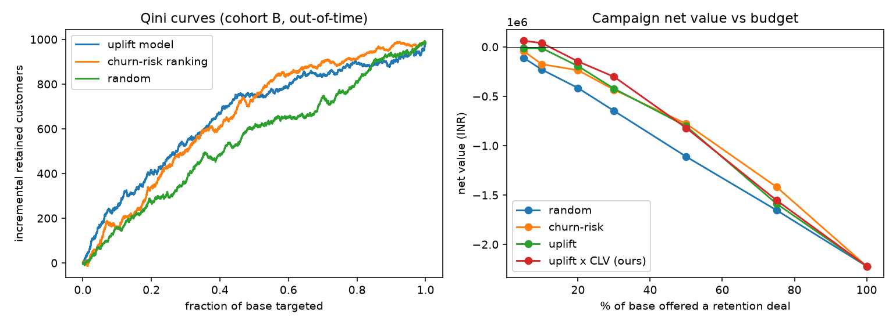

# ChurnGuard

A telecom company has a limited budget for retention offers. Who should get one?
The people most likely to leave are not always the people the offer will save.
This project finds who is worth an offer, using churn risk, uplift and offer cost.

**Note on data:** real telecom data with a randomised campaign is not public, so I simulated 60,000
subscribers (two time periods, monthly usage, support tickets). The true effect of the offer is known in
the simulation, so I can check if the models find it. Results describe the simulation, not a real company.
Costs and policy texts are made up for the demo.

## Pipeline

```
SQL features -> churn risk model --+
randomised campaign -> uplift model +--> net value = uplift x customer value - offer cost --> who gets an offer
                                                                                              |
                                          copilot: reads policy documents, checks rules, writes the message
```

## Results (train on period A, test on later period B)

**Campaign A/B test.** Churn was 8.6% with the offer and 11.5% without: a drop of 2.9 points
(95% CI -3.6 to -2.2, p < 0.001).

**Churn model** (period B, customers without an offer):

| Model | ROC-AUC | PR-AUC | Lift top 10% | Brier |
|---|---|---|---|---|
| XGBoost + calibration | 0.718 | 0.284 | 2.56x | 0.111 |
| Logistic regression | 0.718 | 0.297 | 2.61x | 0.111 |

XGBoost did not beat logistic regression here, because the simulated churn is close to linear.

**Who to give the offer to** (period B, offer cost Rs 120):

| Policy | Net value |
|---|---|
| Offer to everyone | -Rs 22.2 lakh |
| Top 20% by churn risk | -Rs 2.4 lakh |
| Offer only if uplift x value > cost (7.2% of customers) | +Rs 1.1 lakh |

- The net value rule beats the churn-risk rule by Rs 3.6 lakh (95% CI 1.5 to 5.7 lakh).
- The net value rule beats offering everyone by Rs 23.4 lakh.
- The gain over running no campaign is Rs 1.1 lakh, but the CI is -0.9 to +3.0 lakh. This includes zero,
  so I cannot claim the campaign makes money. I can only claim the rule is better than the other two.
- Uplift ranking is only a little better than risk ranking (Qini 0.0054 vs 0.0053).



**Copilot on 3,000 customers:** 92.8% no action, 5.9% offer, 1.2% fix tickets first.

## Files

| File | What it does |
|---|---|
| `src/churnguard/data.py` | simulates subscribers, usage, tickets and the campaign |
| `src/churnguard/features.sql` | SQL features (window functions, trends) with no outcome columns |
| `src/churnguard/models.py` | churn model, uplift model, Qini, policy value, bootstrap |
| `src/churnguard/agent.py` | copilot: finds the right policy, applies rules, writes the message |
| `src/churnguard/api.py` | FastAPI service (`/score/{id}`, `/copilot/{id}`) |
| `scripts/run_all.py` | runs everything in this README |
| `tests/` | 10 tests (SQL check, no leakage, rules, API) |

**Copilot rules:** do not contact if uplift is zero or negative; no offer if net value is negative;
fix open tickets first; respect consent and Do-Not-Disturb; keep offer cost under 15% of yearly spend.
If an LLM is used, it can only reword the message. A check rejects any number that is not in the approved offer.

## Run

```bash
pip install -r requirements.txt
pytest -q
python scripts/run_all.py
CHURNGUARD_BUNDLE=artifacts/churnguard.joblib PYTHONPATH=src uvicorn churnguard.api:app
```

## Limits
- Simulated data. A real campaign is needed to trust the uplift numbers.
- Only about 9,000 customers got the offer, so the uplift signal is weak.
- One random seed.
- Retrieval over 8 policy documents is simple TF-IDF. The copilot is a fixed workflow, not a free agent.
